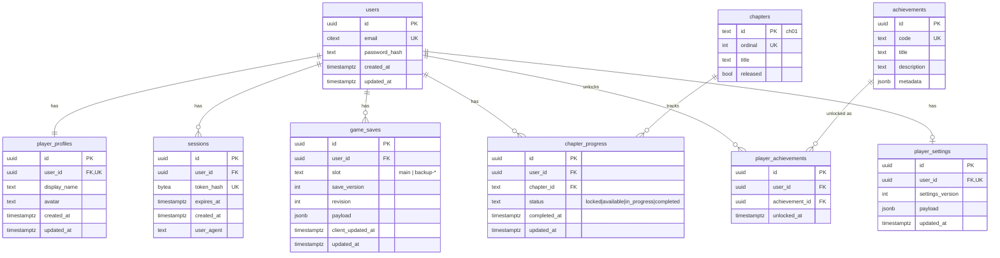

# Database Design (PostgreSQL + Prisma)

## Normalisation decisions

| Data | Storage | Why |
|---|---|---|
| Users, profiles, sessions | Normalised tables | Relational, queried by key, security-sensitive |
| Chapter progress | Normalised `chapter_progress` | Queried for the chapters page and progression validation; small and fixed |
| Achievements | Definitions + join table | Classic many-to-many with unlock timestamps |
| Save snapshot | `game_saves.payload JSONB` | Opaque, versioned game document. The server validates the envelope but never queries inside it |
| Settings | `player_settings.payload JSONB` | Small, versioned, schemaless by design |

The brief's `chapters` entity is a **seeded table**, so chapter progress can use a real foreign key and unreleased chapters can be locked server-side.

## ER diagram

## Constraints and indexes

- `users.email` is `citext UNIQUE`.
- `sessions.token_hash UNIQUE`; index `(user_id)`; expired sessions are swept daily.
- `game_saves UNIQUE (user_id, slot)`; `CHECK (octet_length(payload::text) <= 65536)`.
- `chapter_progress UNIQUE (user_id, chapter_id)`.
- `player_achievements UNIQUE (user_id, achievement_id)`.
- All FKs to `users` use `ON DELETE CASCADE` (account deletion = full erasure, which supports GDPR requests).
- Seeds: chapters `ch01`–`ch07` (only `ch01` released) and the initial achievement set (`FIRST_SLIDE`, `FIRST_WORD`, `WONT_SHUT`, `CH01_COMPLETE`).

- `chapter_progress.status` is a Postgres enum, `chapter_status`.
- Connections are pinned to `TimeZone=UTC` (`apps/api/src/common/db.ts`): with a non-UTC server timezone, Prisma 7's `pg` adapter read `timestamptz` values shifted by the offset. The test database is set to `Asia/Kolkata` so this stays caught on UTC machines.

Migrations are Prisma Migrate SQL files committed under `apps/api/prisma/migrations` (Prisma 7, `prisma.config.ts`). The citext extension and the payload size CHECK are hand-written into the SQL because Prisma doesn't model them. CI validates them against a disposable Postgres 17: drop the schema, `prisma migrate deploy`, then `prisma migrate diff --from-config-datasource --to-schema prisma/schema.prisma --exit-code`. Seeds (`pnpm --filter @the-margin/api seed`) come from `CHAPTERS` and `ACHIEVEMENTS` in `packages/contracts` and are idempotent.
