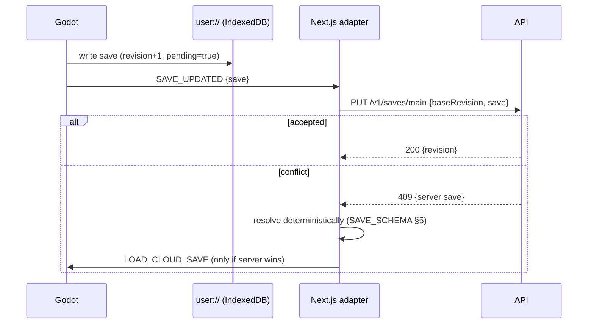

# THE MARGIN — Technical Design Document

> Owner: Principal Game Architect. Covers system architecture, the monorepo, Godot architecture, web/game integration, and browser deployment. The database, save format and API have their own documents: [DATABASE.md](DATABASE.md), [SAVE_SCHEMA.md](SAVE_SCHEMA.md), [../api/API_CONTRACT.md](../api/API_CONTRACT.md).

## 1. System architecture

```mermaid
flowchart LR
  subgraph Browser
    subgraph Next["Next.js site (apps/web)"]
      UI[Pages: landing, play, chapters, profile, settings]
      Adapter[GameBridge adapter<br/>window.TheMarginBridge]
      Sync[Save sync client]
    end
    subgraph Godot["Godot 4.7 Web export (apps/game)"]
      Runtime[Gameplay runtime]
      Local[(user:// to IndexedDB)]
      WB[WebBridge autoload]
    end
  end
  CDN[(S3 + CDN<br/>game builds, assets)]
  API[NestJS API (apps/api)]
  DB[(PostgreSQL)]

  UI --> Adapter
  Adapter <-- versioned JSON messages --> WB
  Runtime --> Local
  Sync -- HTTPS REST, cookie session --> API
  Adapter --> Sync
  API --> DB
  Godot -. loads .wasm/.pck .-> CDN
```

**Ownership boundaries**

| Concern | Owner | Must not |
|---|---|---|
| Physics, puzzles, world state, local saves | Godot | Know about HTTP, accounts or Next.js |
| Accounts, launcher UI, cloud sync orchestration | Next.js | Touch Godot's scene tree or simulate gameplay |
| Persistence, auth, validation, progression rules | NestJS | Contain gameplay simulation |
| Message and payload shapes | `packages/contracts` | Be duplicated by hand elsewhere |

## 2. Monorepo

```text
the-margin/
├── apps/
│   ├── game/        Godot project. Not part of the JS package graph.
│   ├── web/         Next.js (App Router) + TypeScript
│   └── api/         NestJS + Prisma
├── packages/
│   ├── contracts/   Zod schemas: bridge messages, save envelope, API DTOs (source of truth)
│   └── config/      Shared tsconfig / eslint presets
├── infrastructure/
│   ├── docker/      docker-compose for Postgres (local)
│   └── scripts/     export-game, serve-game, verify-export
├── docs/            Design, architecture, ADRs, status
└── .github/workflows/
```

- **Package manager:** pnpm workspaces (pnpm 9 is installed). No Turborepo or Nx until build times justify one (ADR-0006).
- **Godot is not a JS package.** `infrastructure/scripts/export-game.ps1|sh` runs the headless export into `apps/game/build/web`, and CI uploads that folder as an artifact. The web app consumes a game build by URL (`NEXT_PUBLIC_GAME_BUILD_URL`), never by import, which keeps the two release cycles independent.
- `packages/shared-types` from the brief is folded into `packages/contracts`: types are inferred from the Zod schemas (`z.infer`), so a separate types package would only duplicate them.

## 3. Godot architecture

### 3.1 Engine configuration (ADR-0001, ADR-0002, ADR-0013)

| Setting | Value | Why |
|---|---|---|
| Version | Godot 4.7.2-stable | Current 4.x maintenance release (2026-08-18) |
| Renderer | Compatibility (OpenGL ES 3 / WebGL 2) | The only renderer supported for Web export |
| Threads | Off (`variant/thread_support=false`) | No SharedArrayBuffer, so no COOP/COEP headers. The site, embeds and CDN stay simple. |
| Base resolution | 640×360 page units | One comic page per screen. Page data, physics and saves use these units. |
| Stretch | `mode=canvas_items`, `aspect=keep`, `scale_mode=fractional` | Drawing happens at the window's resolution (one unit = 2 px at 720p, 3 px at 1080p), letterboxed on paper colour |
| Textures | Linear filter | No texture art remains; text and figures are vector strokes |
| 2D snapping | Off | Strokes are antialiased; snapping would make thin lines uneven |
| Art | Antialiased vector drawing through `Ink`, `Figures`, `ComicFont`, `LabelTag`, `Prompt` | Hand-inked look; line weight separates usable things from scenery (GDD §9) |
| Physics | 60 Hz | Matches the display target |

### 3.2 Project layout

```text
apps/game/
├── project.godot
├── export_presets.cfg
├── autoload/                 Genuinely global services only
│   ├── event_bus.gd          Typed signals between decoupled systems
│   ├── settings.gd           Volume, reduced motion, input map; user://settings.json
│   ├── audio.gd              SFX voice pool, ambience, chapter music (cross-fade, ducking)
│   ├── save_manager.gd       Versioned save I/O, validation, migrations, backup (user://)
│   ├── game_state.gd         The save document; coalesces dirty events into one write/frame
│   └── web_bridge.gd         JavaScriptBridge adapter; no-op outside web
├── scenes/main.tscn          main.gd: game flow (title → page → turn → end), pause, reset
├── scripts/
│   ├── art/                  palette, ink (vector kit), comic_font (original stroke lettering), figures (Nib,
│   │                         neighbour), label_tag (word tags), prompt (key prompts), draw_layer,
│   │                         baked_layer (static art rendered once to a texture)
│   ├── audio/                sfx_synth, music_synth (procedural, license-clean)
│   ├── page/                 page.gd (builder + runtime), comic_panel.gd, panel_links.gd (pure)
│   │                         panel_drag.gd (reader's hand), story_runner.gd (triggers), page_const.gd,
│   │                         conditions.gd, scene_card.gd, closeup.gd
│   ├── player/               player.gd (movement), player_interaction.gd, sketch_tool.gd (base),
│   │                         player_eraser.gd (X), player_ink.gd (C)
│   ├── words/                word_library.gd (data), word_slot.gd, lettering.gd, speech_bubble.gd, caption.gd
│   ├── objects/              door.gd, crate.gd, button.gd (pressure plate), sketch.gd (pencil),
│   │                         eraser_pickup.gd, ink_drop.gd, npc.gd, prop_painter.gd,
│   │                         feature.gd (conditional parts), page_control.gd (lever, dial)
│   └── ui/                   title_screen, overlays (pause + end card), comic_menu, page_turn, hud
├── data/
│   ├── words.json            Word definitions (data-driven)
│   └── pages/ch01_p01.json   Page definitions: panels, openings, solids, objects, bubbles, triggers
│                             (sb_*.json are mechanic sandboxes, opened with `-- --page=<id>`, never saved)
├── shaders/                  paper, halftone, page_turn (continuous page units, edged per screen pixel)
└── tests/                    Headless test runner + suites
```

### 3.3 Why pages are data, not hand-built scenes

A page is a JSON document that `page.gd` builds into nodes at runtime (ADR-0003). This keeps puzzles **configurable rather than coded**, lets tests load and validate every page headlessly, keeps diffs reviewable, and leaves room for a future level editor. Reusable *behaviour* (doors, NPCs, slots) is code; *composition* is data.

### 3.4 The panel model

- All panels share **one physics space** in page coordinates. Panels never overlap; the drag controller keeps at least one gutter between them. No sub-viewports and no per-panel physics worlds.
- Each panel is a `Node2D` that draws its paper and halftone and clips its contents (`clip_children`). It has one `StaticBody2D` for its border and one for its solids.
- **Border collision is generated** from the panel rect minus any linked opening spans, and rebuilt whenever links change.
- **`PanelLinks` is a pure function** (`compute(panels) -> Array[Link]`) with no node dependencies, so it is fully unit-tested. Rules:
  - *Horizontal link:* `A.right + gutter == B.left`, both have facing openings, the opening bottoms (floor lines) are equal in page space, and the vertical overlap is at least `MIN_PASSAGE_H`.
  - *Vertical link:* `A.bottom + gutter == B.top`, both have facing openings, and the horizontal overlap is at least `MIN_PASSAGE_W`.
  - Each link produces a **gutter bridge**: a floor and ceiling (horizontal) or two walls (vertical) spanning the gutter, so the character can never escape into the void.
- **Moving panels:** `panel_drag.gd` moves a lifted panel along its track in 8 px steps, rejects positions that come closer than one gutter to another panel, and refuses (with shake + deny sound) while the player is inside a gutter bridge or the panel is **pinned** by a word on its caption (`halt`, or `mass` > 1). When a panel moves, everything inside it moves by the same delta, including the player, who is translated explicitly instead of being reparented.

### 3.5 The word model (ADR-0004)

- `words.json`: `{ "OPEN": { "category": "state", "open": true }, ... }`.
- A **WordSlot** is anything that can hold one word: a token in a speech bubble or a narrator caption (both lettered by `lettering.gd`), or an object's label. Caption slots are words written *on the panel*, and the panel obeys them; Nib reaches them from the caption's `reach_at` floor point. Each slot has a stable id (`<owner>:<index>` or `<object>:label`), an `accepts` list of categories (bubble gaps accept everything), and a `loose` flag.
- Objects react in `on_slot_changed(slot)` **by category**, never by word text. A door reads `def.open`; a crate reads `def.dir`; a panel reads `def.mass` from its captions.
- **Crates** (`crate.gd`, `AnimatableBody2D`) move in whole pixels: a `motion` word moves the crate until it is blocked, `halt` holds it (even in mid air), and no label means it falls. A crate never leaves its panel. Nib sits on its own collision layer (`Player.LAYER`), so a crate's collision probes ignore Nib. The crate handles Nib itself: it carries Nib when Nib stands on top, stops when Nib's head would hit something, and never moves into Nib. Crate resting positions are saved as `pages.<id>.objects`. A crate's `mass` label sets its weight (`Crate.weight_for`, 1 as drawn).
- **Platforms** (`platform.gd`, `Platform`, an `AnimatableBody2D` like the crate) run on a `rail` (`{axis, min, max}`, panel-local). No label means shuttle between the rail ends with a `REST` pause; a `motion` word along the rail heads to that end and holds; `halt` holds. The slot's per-word `filter` (`WordSlot.filter`) refuses motion across the rail, and saved slot words are only restored if the slot accepts them. Each pixel step checks the rail, the plank's own `test_move` (with its rider crates excepted), Nib (riding: room above or ahead; not riding: never moved into), and, going up or sideways, every rider crate's `Crate.can_step`; then it moves the plank, Nib and riders together (`Crate.shift`). Nib sets `platform_floor_layers = 0`, so whatever carries Nib (a panel, crate or platform) moves Nib explicitly and no floor adds its own velocity. Platform positions share `pages.<id>.objects` with crates and are restored only if on the rail. A shuttling platform doesn't mark the save dirty at each end; only a labelled move that stops does.
- **Pressure plates** (`button.gd`, `PlateButton`) have no collision; things stand on the floor beneath them. Every physics frame a plate sums the weight whose bottom edge rests on it (Nib 1, each crate its weight, plus Nib if Nib rides that crate) and compares it with `needs × label mass`. A door with `"button": "<id>"` follows that plate's `changed` signal. Plate state is derived from where things rest, so it is never saved; on build the page settles every plate silently before wiring doors (no sounds or events replay).
- **Pencil and the eraser (GDD §4.3).** A panel's `sketches` are pencil lines (`sketch.gd`, `Sketch`, a `StaticBody2D` per line), solid while drawn. Ink solids are never sketches, so ink can't be erased. The eraser is an `eraser` object Nib picks up by walking into it; that adds `"eraser"` to `progress.abilities`, and a page never draws a pickup for an eraser already found. `player_eraser.gd` mirrors `player_interaction.gd`: it targets the nearest sketch in reach in Nib's panel (the one under Nib's feet only as a fallback) and resolves `PlayerEraser.verb_for` to `erase`, `restore`, or a refusal (`full`, `short`, `blocked`) that the prompt explains. Erasing a sketch turns its collision off and leaves its `crumbs` (default 1); restoring costs them and is refused over Nib or a crate. **Crumbs are derived, never stored:** `ComicPage.crumbs()` sums each sketch's difference from how it was drawn, so the eraser can't hold more than `eraser_holds` (page data, default 3), and a save implying an impossible count resets the page's sketches.
- **Ink (GDD §4.4).** A sketch with an `ink` cost (shown as dots above it) can be traced: `player_ink.gd` (C) spends that many drops from Nib's hat and turns the sketch into ink, which is solid and permanent. The eraser never targets ink. A `faint` sketch is a layout line, drawn but not solid until inked; this is how a "sketched bridge" becomes real while ordinary pencil stays solid for the eraser. Tracing a faint sketch is refused around Nib or a crate. Ink comes from `ink` objects (a drop, or an inkwell with `drops`), collected by walking in if the hat (`ink_holds`, default 3) has room for all of it; the first one adds `"ink"` to `progress.abilities`. Ink in the hat is derived like crumbs: drops collected on the page (`pages.<id>.collected`) less the cost of inked sketches.
- Both tools extend `SketchTool` (`sketch_tool.gd`), which owns the reach rules, the per-tool highlight, the refusal prompts and the pips above Nib. When both tools have a target, their prompts stack.
- World state for words is just `slot_id -> word_id`, plus the carried word. That is trivially serialisable and restores deterministically.

### 3.6 Interaction

`player_interaction.gd` keeps a list of `WordSlot`s registered with the current page. Each frame it picks the best candidate in reach (same panel, within an x/y radius of the slot's interaction anchor; for bubbles, the anchor is the speaker; a fallen bubble with no speaker is solid and is read standing on it, so its anchor is the top of the bubble above each word), then resolves the verb from the hand/slot state:

| Hand | Slot | Verb |
|---|---|---|
| empty | has loose word | take |
| word | empty and accepts | place |
| word | has loose word and accepts | swap |
| any | other | none (no prompt) |

The player controller never knows what a door or a bubble is. The eraser (X) and ink (C) have their own keys and their own targeting (§3.5), so a word and a pencil line in reach never compete for E.

### 3.7 Story triggers

Page data declares `triggers: [{ on, when?, once, do: [actions] }]`. Events come from the EventBus (`panel_moved`, `link_formed`, `word_taken`, `word_placed`, `page_entered`, `panel_entered` (Nib is now wholly inside a panel, having last been inside another), `door_opened`, `button_pressed`, `button_released`, `eraser_found`, `sketch_erased`, `sketch_restored`, `ink_collected`, `sketch_inked`, `scene_changed` {panel, scene}, `switch_changed` {switch, on}). Actions are a small whitelist: `wait`, `rewrite_caption`, `write_caption`, `shake_panel`, `sfx`, `end_card`, `turn_page` (leave for `next`, as an exit door does), `erase_panel`, `emit`. Fired `once` triggers are recorded in page state so they don't replay after loading.

**`erase_panel {panel, respawn}`** is the artist rubbing a whole panel out (page 1.8). It first waits until Nib is wholly inside another panel, so nobody is erased with the room. Then the panel stops being a room at once: its border and solids lose their collision layer, it reports no openings (so its links close), it no longer encloses anything, and `_panel_fits` ignores it, so a lifted panel may slide into the space it leaves. Nib is nudged clear of the border that just closed (being wholly inside a panel still overlaps its border collision by up to 6 px). The drawing is then rubbed away in 16 px rows, back and forth, holding the music duck, and only a smudge, crumbs and a ghost border are left. `respawn` moves the page spawn out of the room. Page validation requires the erased panel to be fixed and to hold nothing the page needs (objects, NPCs, bubbles, sketches, caption words). A panel can also start `erased` in data, as a smudge where an earlier page had a room.

**Restore order.** A page restores lasting erasures (and their respawn) before anything else, then lifted-panel positions, then Nib. Saved panel positions are checked against each other only after all of them are applied, because one panel may rest where another started (page 1.7's R rests over V's start). If any clash, all of them start over.

### 3.7b Scene captions, close-ups and conditional features (GDD §4.7, §4.8)

- **`Conditions`** (`page/conditions.gd`) evaluates a condition string against a panel's scene (`later`, `night`, or "" for now) and the page's switches: a term, optionally negated with `!`, joined with `&`.
- **`Feature`** (`objects/feature.gd`) is a panel part that exists while its `when` holds: `vine` (leaves are one-way ledges), `ice`, `gate`, `glow_steps` (one-way), `glow_text`. Each has its own `StaticBody2D` whose collision layer is switched on and off, and animates growing or melting (cut under reduced motion). NPCs (`when`, `solid`, `pose: "asleep"`) and props (`when`) follow conditions the same way.
- **`SceneCard`** (`page/scene_card.gd`) is a page-level caption card in a panel's top-right corner. `ComicPage.move_card` checks first that no feature would turn solid over Nib or a crate, then moves it, re-evaluates every condition (`refresh_conditions`) and emits `scene_changed` for both panels. `ComicPanel.set_scene` re-bakes the ground (conditional props) and draws the scene layer (night wash and moon, or LATER cobwebs) between the ground and the room's contents.
- **`PageControl`** (`objects/page_control.gd`, a `lever` or a `dial` object) is a switch, drawn small in its panel. **`CloseUp`** (`page/closeup.gd`) is a round inset at a fixed page point with a fixed focus ring. It shows whichever control's global position is within the ring, drawn big, and turns hand clicks into `pull()` or `turn(wheel, ±1)`. Controls emit `changed`, which re-evaluates conditions, powers wired doors (`button: "<control id>"`, as with plates) and emits `switch_changed`.
- **The reader's hand** (`page/panel_drag.gd`) works lifted panels, cards and close-ups by mouse; panel mode (Q) cycles through all three.
- **Save:** `pages.<id>.scenes` (card → panel) and `pages.<id>.controls` (lever bool or dial digits). Cards are restored together, like panel positions: if two would share a panel, all start where the page puts them.
- **Validation** (`test_pages`): known feature kinds inside their panels; conditions name only scenes or switches on the page; a character that comes and goes has no words in its bubble; cards start on inked panels, one per panel; close-ups sit on the page and cover no panel.

### 3.7a Music

`data/music.json` holds one score per track: `bpm`, `bars`, `steps_per_bar`, `steps_per_beat`, an optional `volume_db`, and voices `{instrument, volume, pattern}`. A pattern has one token per step: a note or chord (`A3+E4`), `-` to hold, `.` for a rest, and `|` as a bar mark for the reader. A pattern may be shorter than the loop if it divides it evenly; it repeats. The instruments are `felt`, `pluck`, `pad` and `tap`. Each is a stateless function of time, so `MusicSynth` renders any slice of the loop independently. Notes mix into a circular buffer whose tails wrap past the loop point, so every loop is seamless.

A page plays its `music` field if it has one (`""` is silence); otherwise it plays the track named after its `chapter`, if one exists. Turning to a page with the same track never restarts it; a different track cross-fades over 1.5 s.

**Building without threads (ADR-0001):** a track renders a slice per frame within a time budget of 4 ms during play and 12 ms while no page runs. The title screen warms up the track for the page play will resume on. Measured on the web export, `ch01` (23 s at 16 kHz) is ready 2.8 s after boot in Chromium and 1.9 s in WebKit (macOS, 2026-11-06).

**Ducking:** the music drops 12 dB while the artist intervenes. Holds nest (`Audio.duck_hold`/`duck_release`). An artist-style caption holds the duck while it is lettered and releases it if freed mid-sentence; `shake_panel` ducks for 1.5 s.

### 3.8 Autoloads

Only six, each with a single responsibility (see §3.2). Game flow lives in `main.gd`, not an autoload, because nothing else needs to reach it. Gameplay systems (panels, words, interaction) are **not** autoloads; they live in the page scene and are discovered through the page.

### 3.9 Testing (ADR-0005)

A small in-house headless runner (`godot --headless --path apps/game -s res://tests/run_tests.gd`) runs `test_*.gd` suites and exits non-zero on failure. It covers the link solver, word library, slot verbs, save round-trip and migration, page-data validation for every page, and a scripted **solution playthrough** that builds the real page, drives the solution through public APIs, and asserts the exit opens. Browser behaviour is covered separately by Playwright against the real export (§5.4).

## 4. Web ↔ game integration

### 4.1 Message contract (`packages/contracts/src/bridge.ts`)

Every message is `{ v: 1, type, payload }`, serialised as JSON.

**Game → web:** `GAME_READY`, `GAME_STARTED`, `GAME_PAUSED`, `GAME_RESUMED`, `SAVE_UPDATED {save}`, `SETTINGS_UPDATED {settings}` (once the bridge is up, then on every change), `CHAPTER_COMPLETED {chapterId}`, `PAGE_COMPLETED {pageId}`, `ACHIEVEMENT_UNLOCKED {code}`, `GAME_EXITED`, `GAME_ERROR {message}`.

**Web → game:** `LOAD_CLOUD_SAVE {save}`, `SET_SETTINGS {settings}` (any subset of the settings, plus a transient `muted` the game never saves), `PAUSE`, `RESUME`, `REQUEST_SAVE`.

Settings belong to the game (`user://settings.json`). The site keeps a mirror from `SETTINGS_UPDATED`, its settings page edits that mirror, and the launcher sends it with `SET_SETTINGS` before the engine starts, so the pause menu and the site never disagree for long.

### 4.2 Mechanism

- The host page defines `window.TheMarginBridge = { onGameMessage(json) {}, _inbox: [] }` **before** loading the engine.
- **Game → web:** `web_bridge.gd` gets the bridge with `JavaScriptBridge.get_interface("TheMarginBridge")` and calls `onGameMessage(json)` on it (no `eval`: no string-escaping risk). If the interface is missing, the game sends nothing, so the export also runs standalone.
- **Web → game:** on start, the game registers a callback (`JavaScriptBridge.create_callback`) as `window.TheMarginBridge.deliver`, then drains `_inbox` for messages queued before it was ready. The adapter calls `deliver(json)` after that.
- Both sides validate: the web side with Zod; the game side checks `v`, `type` and the payload shape, and ignores unknown types.
- No WebSockets. Cloud sync is plain HTTPS from the web app; the game never makes network requests.

### 4.3 Save flow



Local save is always written first. Cloud is an asynchronous mirror and a failure there never blocks play. Pending syncs retry with exponential backoff (2 s doubling to 5 min) and on `online` / `visibilitychange`.

Implementation (`apps/web/src/sync/`): `SaveSync` keeps `{userId, cloudRevision, pending}` in `localStorage` (`the-margin.sync`). On `/play` it first reconciles the browser's save (the game's `localStorage` mirror) with `GET /saves/main`:
- With no cloud save, it uploads the local one.
- With no local save, it loads the cloud save into the game.
- If the cloud is still at `cloudRevision`, it pushes only if something is pending.
- Otherwise it resolves the two saves (SAVE_SCHEMA §5).

After that, every `SAVE_UPDATED` is pushed on the revision it was based on. A retry that is waiting carries the newest save, so offline play costs one push when the connection returns. Saves are compared key-order-insensitively, because Postgres JSONB reorders keys. `LOAD_CLOUD_SAVE` is sent only after `GAME_READY`: the game drains queued messages in its bridge autoload, before its main scene listens for cloud saves. Chapter completions and achievement unlocks go through an outbox (`the-margin.outbox`) that survives reloads; their endpoints are idempotent. `SETTINGS_UPDATED` is pushed after a 1 s debounce, and cloud settings fill a browser that has none. A 401 stops syncing; play carries on locally.

## 5. Browser deployment strategy

### 5.1 Build

- `godot --headless --path apps/game --export-release "Web" build/web/index.html` produces `index.html`, `index.js`, `index.wasm` (~35 MB uncompressed, ~9 MB Brotli), `index.pck`, `index.audio.worklet.js`, and icons.
- The template is single-threaded, so it needs **no** cross-origin isolation headers.
- CI validates that the artifacts exist, their size budget, and a boot smoke test in headless Chromium.

### 5.2 Hosting

| Piece | Host | Notes |
|---|---|---|
| Game builds | Bundled into the site's Vercel deployment at `/game` (ADR-0012) | Same origin, deployed and rolled back with the site, compressed at Vercel's edge. A CDN folder (S3 + CloudFront with immutable caching) remains possible through `NEXT_PUBLIC_GAME_BUILD_URL`. |
| Web | Vercel | Proxies `/v1/*` to the API, so cookies are first-party |
| API | Fly.io (`apps/api/Dockerfile`, `fly.toml`) | One container in Singapore; migrations and seed run as the release command; health check at `/v1/health` |
| DB | Neon Postgres (same region) | Direct connection (the pooler rejects the UTC startup option); daily snapshots + PITR per Neon's plan |

Staging setup, deploys and rollback are in [DEPLOY.md](../DEPLOY.md).

### 5.3 Embedding

The `/play` page loads the engine script from the build URL and runs it on a `<canvas>` inside a launcher shell (loading bar from Godot's `onProgress`, error and unsupported-browser states, fullscreen, mute, back to site). It does **not** use the exported `index.html`; it drives the `Engine` API directly (`apps/web/src/game/Launcher.tsx`):

1. Install `window.TheMarginBridge` and queue `SET_SETTINGS` from the site's mirror.
2. Fetch `build.json` (written by the export script: executable name, versions, file sizes for the progress bar).
3. Load `<build>/index.js`, check `Engine.getMissingFeatures`, then `init` the engine, preload the pack to the fixed in-memory path `index.pck`, and `start` with `--main-pack index.pck`, so a build works from any URL.
4. Resize policy 0: the launcher sizes the canvas in device pixels to fill the stage below its toolbar, and Godot scales the page to fit inside it (ADR-0013). Fullscreen is requested on the stage, not by Godot.

An engine can start only once per document, so every link to and from `/play` is a full page load. The canvas takes focus on start and again after toolbar clicks. The launcher also re-dispatches every game message as a `themargin:message` DOM event.

### 5.4 Browser verification

Playwright runs against the actual export served locally: boot, `GAME_READY` received, screenshot sanity, a scripted solution through real input, a reload that verifies IndexedDB persistence, and console error capture. Targets: Chromium, Firefox and WebKit (WebKit is opt-in with `E2E_WEBKIT=1` and is run on macOS).

## 6. Security posture (summary)

- Sessions use an opaque random token in an `HttpOnly; Secure; SameSite=Lax` cookie, stored **hashed** in Postgres (ADR-0007). CSRF uses the double-submit token for state-changing requests plus an Origin check.
- Argon2id password hashing, rate limiting on auth routes, Helmet headers, a strict CORS allowlist, and Zod validation with payload size limits (saves ≤ 64 KB).
- All client game state is treated as untrusted. The server validates progression transitions (no completing chapter N+1 before N) but does not attempt anti-cheat.
- No secrets in `NEXT_PUBLIC_*` or game assets.

## 7. Performance budgets

| Metric | Budget |
|---|---|
| Frame time | ≤ 16.6 ms on integrated GPUs (Intel Iris Xe class) |
| Draw calls per page | < 150 |
| Initial download (compressed) | < 15 MB |
| Page build time | < 50 ms |
| Memory after 30 min | No growth beyond ±5 % of the post-load baseline |
| Network during gameplay | 0 requests from the game; sync only from the site |
